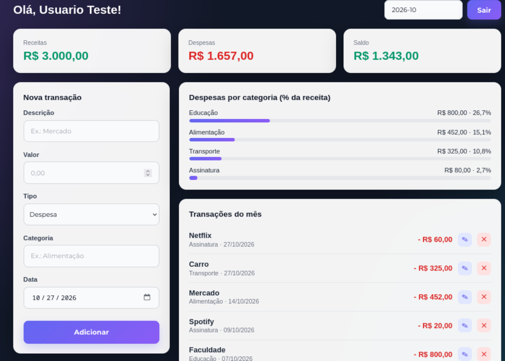

# Controle Financeiro Pessoal

Aplicação web para controle de finanças pessoais. O usuário cria uma conta, faz login e registra suas receitas e despesas, acompanhando o saldo do mês e quanto cada categoria consome da sua renda.

O projeto tem uma **API REST** em Java com Spring Boot e um **front-end** em HTML, CSS e JavaScript puro.



## Funcionalidades

- Cadastro de usuário com validação dos campos
- Login com autenticação por **JWT**
- Senhas criptografadas com **BCrypt**
- Cadastro, edição e exclusão de transações (receitas e despesas)
- Filtro por mês
- Despesas por categoria, em porcentagem da receita do mês

## Tecnologias

**Back-end**
- Java 21
- Spring Boot 4 (Web MVC, Data JPA, Validation, Security, OAuth2 Resource Server)
- MySQL
- Lombok
- Maven

**Front-end**
- HTML5, CSS3 e JavaScript (Fetch API)

## Estrutura do projeto

```
projeto/
├── src/main/java/br/com/desenvolvendoapi/projeto/

│   ├── config/        # SecurityConfig (rotas e CORS), JwtConfig (chave e codificação do token)

│   ├── controller/    # UsuarioController, TransacaoController, ApiExceptionHandler

│   ├── service/       # UsuarioService, TransacaoService, TokenService

│   ├── DAO/           # Repositórios JPA (IUsuario, ITransacao)

│   └── model/         # Entidades e objetos de resposta

├── src/main/resources/application.properties

└── pom.xml

front/
├── index.html / script.js     # Cadastro

├── login.html / login.js      # Login

├── home.html / home.js        # Painel financeiro

└── style.css / home.css
```

## Como executar

### Pré-requisitos
- Java 21
- Maven
- MySQL em execução na porta 3306

### 1. Variáveis de ambiente

A aplicação não guarda senhas no código. Defina as variáveis antes de rodar:

| Variável | Descrição | Padrão |
|---|---|---|
| `DB_USER` | Usuário do MySQL | `root` |
| `DB_PASSWORD` | Senha do MySQL | (obrigatória) |
| `JWT_SECRET` | Chave de assinatura do token, com **pelo menos 32 caracteres** | (obrigatória)

### 2. Banco de dados

O banco `banco_usuario` e as tabelas `usuario` e `transacao` são criados automaticamente na primeira execução (`createDatabaseIfNotExist=true` e `ddl-auto=update`).

### 3. Subir a API

```bash
mvn spring-boot:run
```

A API fica disponível em `http://localhost:8080`.

### 4. Abrir o front-end

Abra a pasta do front-end com o **Live Server** (VS Code) ou outro servidor estático, usando a porta **5500**. O CORS da API libera `http://127.0.0.1:5500` e `http://localhost:5500`.


## Endpoints

### Usuários

| Método | Rota | Autenticação | Descrição |
|---|---|---|---|
| POST | `/usuarios` | Não | Cadastra um usuário |
| POST | `/usuarios/login` | Não | Valida e-mail e senha, devolve o token e os dados do usuário |
| GET | `/usuarios/me` | Sim | Dados do usuário logado |
| PUT | `/usuarios` | Sim | Edita a própria conta |
| DELETE | `/usuarios/{id}` | Sim | Exclui a própria conta (403 para outro id) |

### Transações

Todas exigem o header `Authorization: Bearer <token>`. O usuário é identificado pelo token.

| Método | Rota | Descrição |
|---|---|---|
| GET | `/transacoes?mes=10&ano=2026` | Lista as transações (sem `mes` e `ano`, lista todas) |
| GET | `/transacoes/resumo?mes=10&ano=2026` | Receitas, despesas, saldo e despesas por categoria |
| POST | `/transacoes` | Cria uma transação |
| PUT | `/transacoes/{id}` | Edita uma transação |
| DELETE | `/transacoes/{id}` | Exclui uma transação |

### Exemplos


## Próximos passos
- [ ] Gráficos (pizza de categorias e evolução mensal)
- [ ] Metas e limites por categoria
- [ ] Transações recorrentes
- [ ] Exportação para CSV
- [ ] Documentação com Swagger
- [ ] Testes automatizados
- [ ] Deploy
